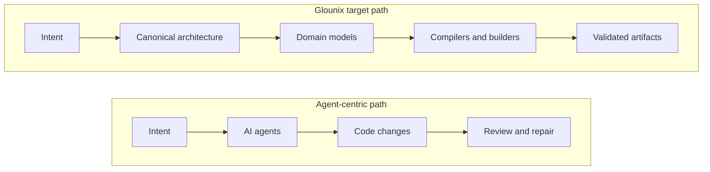
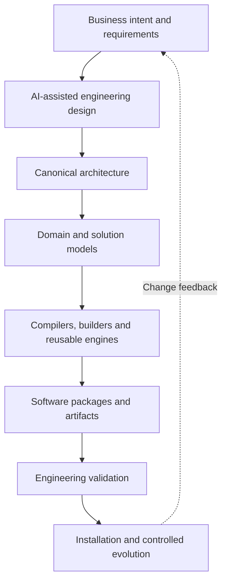

# Glounix Factory

**Make Software Engineering Compilable.**

*A model/compiler-driven software production initiative for complex enterprise systems.*

[Official website](https://factory.simorghhub.com) · [Founder portfolio](https://resume.simorghhub.com) · [Contact](mailto:info@simorghhub.com)

> **Project status:** Active research and development. This is a **public information repository**, not the proprietary Factory source repository. Descriptions of the target architecture are not claims that every component is complete or commercially validated.

## Two approaches to the future of software engineering

**Agent-centric development** seeks to make AI a better programmer: agents plan, change source code, run checks, and iterate.

**Glounix Factory** pursues a different direction: make more of software engineering *compilable*. AI can help interpret requirements and propose designs; explicit engineering models and production contracts guide compilers, builders, and validation systems.

These are conceptual patterns, not a scored or independently verified comparison of competing products.

## The production thesis

The objective is to shift repeatable engineering work from unconstrained code generation to modeled, validated production—while retaining human oversight and extension mechanisms for cases that cannot be fully modeled.

## Engineering principles

- **Architecture as a production contract:** explicit domains, dependencies, constraints, and interfaces.
- **Model/compiler-driven production:** defined transformations for repeatable software structures.
- **Standards-informed governance:** a referenced set of **19 engineering standards** informs the program; applicability and enforcement must be evaluated individually. This is **not** a claim of certification or full compliance.
- **Independent validation:** produced artifacts should be checked against engineering requirements, not merely accepted because generation succeeded.
- **Composable capabilities:** reusable engines and pluggable components are an architectural objective.
- **Lifecycle thinking:** initial generation, installation, change, compatibility, and migration belong to the same engineering problem.

Explore [public architecture](docs/architecture/README.md), [engineering principles](docs/engineering/README.md), and [public development updates](updates/README.md).

## Current progress and evidence

Glounix is a founder-led initiative with reported work on platform foundations, model and generation infrastructure, validation, and enterprise-solution experiments. The full target lifecycle has **not** been independently demonstrated through a public benchmark. Public updates distinguish implemented, tested, and planned capabilities.

No unsupported claims about customer deployments, compliance certification, performance improvements, or production SLAs are made here.

## What this repository contains

- Public-facing positioning and high-level architecture diagrams
- Engineering principles and public-safe evaluation criteria
- Approved development communications and media references
- Security-contact and intellectual-property notices

**Not included:** proprietary source code, compiler algorithms, canonical schemas, internal production contracts, credentials, private infrastructure, FYA records or agent-training datasets, and customer information.

## Collaboration

We welcome discussions about software production architecture, technical evaluation, strategic collaboration, and research.

- Website: https://factory.simorghhub.com
- Portfolio: https://resume.simorghhub.com
- Contact: info@simorghhub.com

© 2026 Simorgh Software Development. All rights reserved. See [NOTICE](NOTICE.md).
