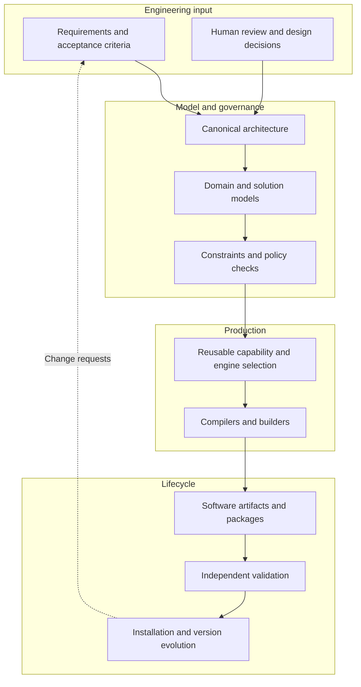

# Public architecture overview

Glounix Factory is being developed around the hypothesis that a significant portion of enterprise software construction can be expressed as **structured engineering intent** and translated into software artifacts through controlled builders and compilers.

## Target system boundaries

This diagram is intentionally **conceptual**. It does not expose private production contracts, internal models, implementation sequence, or complete runtime boundaries.

## Why models matter

Generated code can be syntactically valid and still violate domain invariants, security boundaries, or future migration requirements. The proposed approach puts explicit domain and architectural constraints upstream of production and treats validation as a distinct responsibility.

## Determinism and its limits

A deterministic transformation can make outputs repeatable **for fixed models, compiler versions, and environments**. It does **not** prove that requirements were understood correctly, that every business rule was modeled, or that the resulting system is secure. Those require dedicated reviews and tests.

## Enterprise engineering scope

The target addresses data models, APIs, authorization, workflow, application interfaces, packaging, compatibility, and controlled evolution. The platform is not described here as having demonstrated universal automatic production for every application category.

## Further reading

- [Engineering principles and evaluation](../engineering/README.md)
- [Main README](../../README.md)
